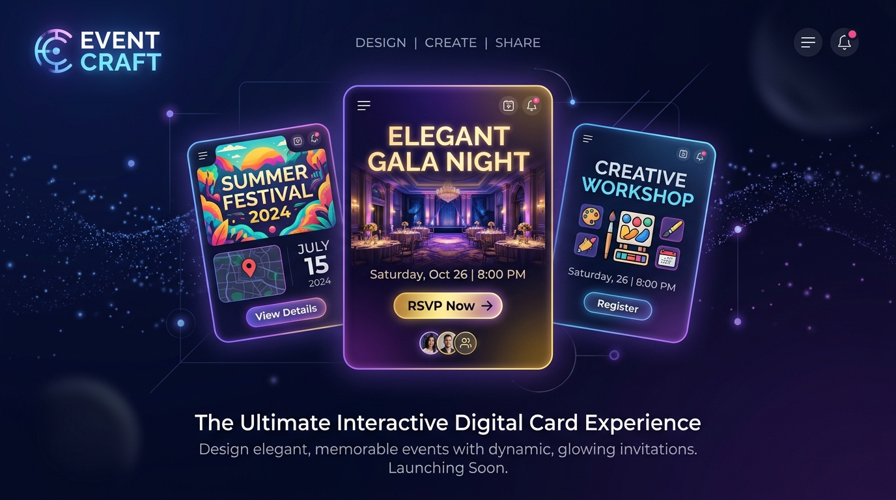

# Event Craft

[](https://nextjs.org/)
[](https://react.dev/)
[](https://www.typescriptlang.org/)
[](https://tailwindcss.com/)
[](LICENSE)

An open-source, interactive digital card and micro-experience builder. Event Craft transforms static greetings and invitations into memorable mini-apps that recipients can tap, play, reveal, solve, and explore.



---

## Key Features

### 500+ Mini-Apps and Themes
- **Interactive Requests**: Date requests with evading buttons, captcha proposals, and countdown timer gates.
- **Milestones & Games**: Birthday balloon popping, digital scratch-offs, 8-bit RPG quests, memory match, slot machines, and jigsaw puzzles.
- **Group Experiences**: Collaborative mosaics, audio guestbooks, live sentiment tickers, shared bingo boards, and crowd-sourced itineraries.

### Dynamic Rendering Engines
- **Canvas Systems**: Real-time particle canvases (stars, sakura, rose petals, fireflies), physics simulations, snowfall, rain, and mesh gradients.
- **Effects & Overlays**: Glitch overlays, 3D card flips, tilt parallax, typewriter text, and audio visualizers.
- **Unwrapping Presets**: Delivery experiences including wax-sealed envelopes, scrolls, gift boxes, holographic portals, paper airplanes, and vintage bottles.

### Visual Editor & Asset Suite
- **Drag-and-Drop Stickers**: Multi-selection, rotation, depth layering, alignment guides, and nudge controls.
- **Audio Soundscapes**: Ambient background presets (acoustic, lofi, synthwave, orchestral) and sound effects (applause, cork pop, shutter, typewriter).
- **Personalization**: Dynamic font pairings, HSL color palettes, emotional tone sliders, and media uploads.

---

## Overview

| Component | Responsibility | Tech / Files |
| :--- | :--- | :--- |
| **Theme Registry** | Definitions for 500+ themes across 30+ categories | `lib/themes/definitions/` |
| **Experience Host** | Dynamic lazy-loading of individual mini-apps | `components/themes/experiences/ExperienceHost.tsx` |
| **Renderer Engine** | Fallback metadata-driven layout and visual canvas | `components/themes/renders/ThemeRenderer.tsx` |
| **Editor Suite** | Full drag-and-drop customization workspace | `components/editor/` |
| **Backend & Storage** | Event scheduling, RSVPs, storage buckets, and auth | `supabase/` |

---

## Quick Start

### Prerequisites
- Node.js 18.x or higher
- npm, pnpm, or yarn

### Installation & Local Setup

1. Clone the repository:
   ```bash
   git clone https://github.com/justininuk-pixel/Event_Craft.git
   cd Event_Craft
   ```

2. Install dependencies:
   ```bash
   npm install
   ```

3. Setup environment variables (optional for local dev):
   ```bash
   cp .env.example .env
   ```

4. Launch the local development server:
   ```bash
   npm run dev
   ```

5. Open [http://localhost:3000](http://localhost:3000) in your browser.

---

## Development & Build Commands

| Command | Purpose |
| :--- | :--- |
| `npm run dev` | Starts Next.js development server at localhost:3000 |
| `npm run build` | Builds optimized production bundle |
| `npm run start` | Starts Next.js production server |
| `npm run lint` | Runs ESLint across codebase |
| `npx tsc --noEmit` | Performs full TypeScript type checking |

---

## Project Structure

```
Event_Craft/
├── app/                  # Next.js App Router
│   ├── api/              # AI endpoints, theme loaders, upload handlers
│   ├── c/[cardId]/       # Public recipient card view
│   ├── collab/           # Real-time collaborative editor
│   ├── dashboard/        # Card analytics, RSVPs, and calendar
│   ├── editor/           # Card customization workspace
│   └── explore/          # Mini-app and theme gallery
├── components/           # UI components
│   ├── dashboard/        # Contribution managers and widgets
│   ├── editor/           # Canvas tools, sticker layers, timeline controls
│   ├── gallery/          # Category filters and theme cards
│   └── themes/           # Interactive experience mini-apps and visual engines
├── lib/                  # Application core
│   ├── audio/            # WebAudio manager and preset tracks
│   ├── db/               # Supabase database client and schemas
│   └── themes/           # Theme definitions, palettes, and categories
├── public/               # Assets (audio tracks, sfx, sticker SVGs, hero banner)
└── supabase/             # Database migrations and edge functions
```

---

## Documentation

For detailed information regarding mini-app mechanics, visual engine architecture, and platform vision, see [ABOUT.md](./ABOUT.md).

---

## License

This project is licensed under the MIT License, see the [LICENSE](LICENSE) file for details.
